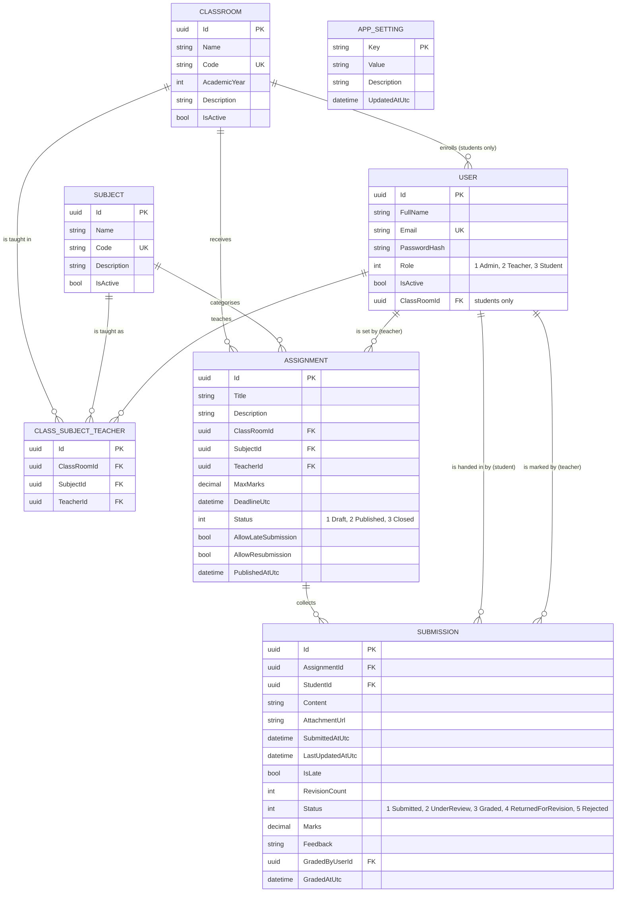

# Database design

## Entity relationship diagram

`APP_SETTING` has no relationships: it is a small key/value table for institution-wide switches.

## Keys and constraints

| Constraint | Table | Why |
| --- | --- | --- |
| Unique `Email` | Users | Sign in is by email |
| Unique `Code` | ClassRooms, Subjects | Human-readable identifiers stay unambiguous |
| Unique `(ClassRoomId, SubjectId, TeacherId)` | ClassSubjectTeachers | A teacher is mapped to a pair once |
| Unique `(AssignmentId, StudentId)` | Submissions | One submission per student per assignment |
| Index `(ClassRoomId, Status)` | Assignments | The student list query filters on exactly this |
| Index `Status`, `StudentId` | Submissions | Marking queues and per-student history |
| Index `DeadlineUtc` | Assignments | "Upcoming only" filtering |

## Delete behaviour

| Relationship | Behaviour | Reasoning |
| --- | --- | --- |
| Assignment → Submissions | Cascade | Submissions have no meaning without the assignment, and an assignment with submissions cannot be deleted anyway |
| ClassRoom / Subject / Teacher → Assignment | Restrict | Deleting a class must never quietly remove academic work |
| ClassRoom / Subject / Teacher → ClassSubjectTeacher | Cascade | The mapping is pure metadata |
| Student → Submission | Restrict | A student with submitted work cannot be deleted; deactivate instead |
| GradedByUser → Submission | Set null | Marks survive even if the marker's account is later removed |

Application-level rules go further than the foreign keys: the services refuse to delete an
assignment that has submissions, a user with academic history, or a class that still has students.
